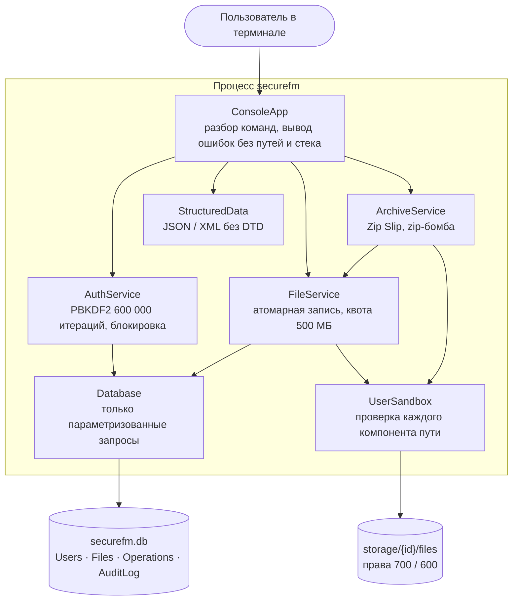
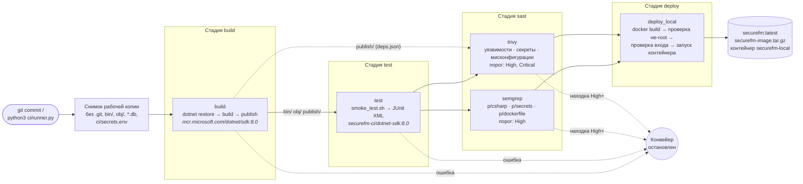
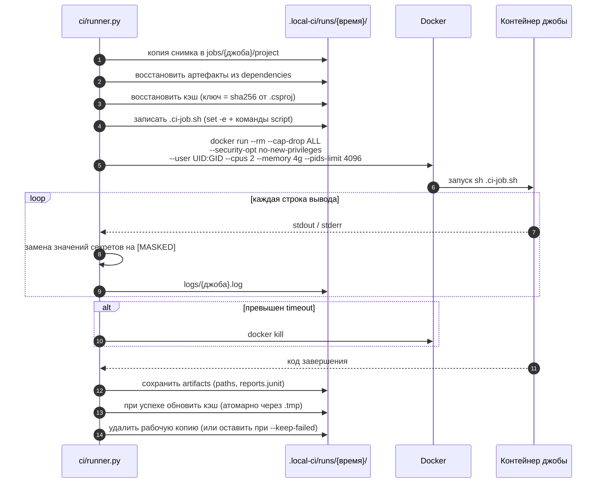
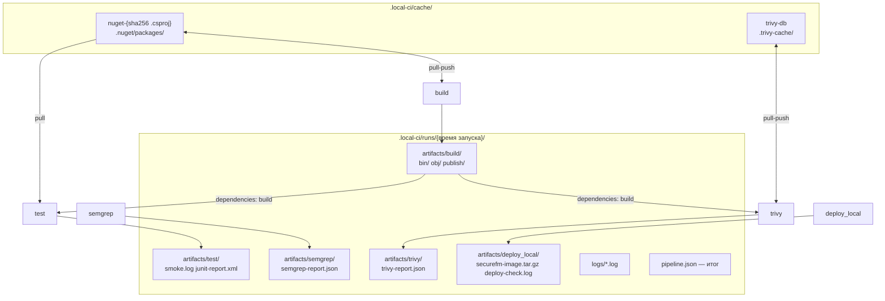
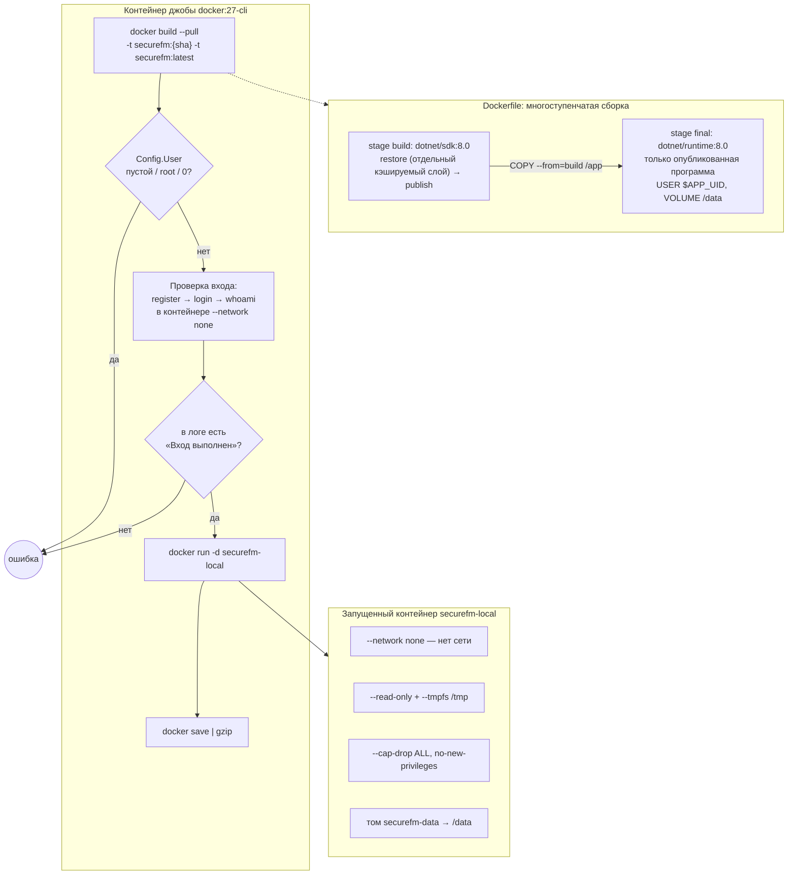
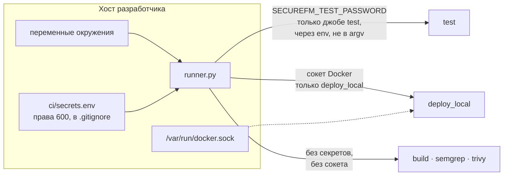

# SecureFileManager — безопасный консольный файловый менеджер

Консольное приложение на **C# / .NET 8** для Linux (Ubuntu) с базой данных **SQLite**, защитой от типовых атак
на файловые операции и **локальным конвейером CI/CD**: сборка → автотесты → статический анализ безопасности → развёртывание в Docker.

> Конвейер описан в `.gitlab-ci.yml` (синтаксис GitLab CI), но выполняется **собственным Python-раннером**
> `ci/runner.py` на машине разработчика: каждая джоба запускается в отдельном изолированном Docker-контейнере.
> Облачный CI не нужен, GitHub используется только для хранения кода.

---

## Содержание

1. [Возможности приложения](#1-возможности-приложения)
2. [Структура репозитория](#2-структура-репозитория)
3. [Архитектура приложения](#3-архитектура-приложения)
4. [Модель защиты](#4-модель-защиты)
5. [Устройство CI/CD](#5-устройство-cicd)
6. [Быстрый старт](#6-быстрый-старт)
7. [Автотесты](#7-автотесты)
8. [Известные ограничения](#8-известные-ограничения)
9. [Вопросы на защите — короткие ответы](#9-вопросы-на-защите--короткие-ответы)

---

## 1. Возможности приложения

| Требование задания | Команды / реализация |
|---|---|
| Диски и свойства файловой системы | `drives` |
| Чтение, запись, удаление файлов и каталогов | `read`, `write`, `overwrite`, `append`, `rm`, `ls`, `info`, `mkdir`, `rmdir [-r]` |
| Работа с JSON и XML | `json-write`, `json-read`, `xml-write`, `xml-read`, `report-json`, `report-xml`, `report-show` |
| Архивы ZIP | `zip <источник> <архив.zip>`, `unzip <архив.zip> <новый_каталог>` |
| База данных | таблицы `Users`, `Files`, `Operations` (`src/Database.cs`), команда `files` |
| Журнал активности | таблица `AuditLog` (только добавление), команда `log [N]` |
| Учётные записи | `register`, `login`, `logout`, `whoami` |

Данные хранятся в `~/.local/share/securefm`, другой каталог задаётся переменной `SECUREFM_HOME`
(в Docker-образе это `/data`).

---

## 2. Структура репозитория

```text
SecureFileManager/
├── .gitlab-ci.yml               # описание конвейера: стадии build → test → sast → deploy
├── Dockerfile                   # многоступенчатая сборка образа приложения
├── .dockerignore                # в контекст образа попадают только .csproj и src/
├── .semgrepignore               # служебные каталоги, которые Semgrep не сканирует
├── .gitattributes               # LF для скриптов (иначе shebang ломается в Linux)
├── .gitignore                   # bin/, obj/, *.db, .local-ci/, ci/secrets.env …
├── SecureFileManager.csproj     # проект .NET 8, зависимость Microsoft.Data.Sqlite
│
├── src/                         # исходный код приложения
│   ├── Program.cs               # точка входа: каталог данных, права 700, запуск консоли
│   ├── ConsoleApp.cs            # разбор команд, вывод, классификация ошибок
│   ├── Auth.cs                  # PBKDF2-SHA256, регистрация, вход, блокировка
│   ├── Database.cs              # весь SQL: параметризованные запросы, триггеры журнала
│   ├── UserSandbox.cs           # «песочница» пользователя: проверка путей и ссылок
│   ├── FileService.cs           # атомарная запись, удаление, квота
│   ├── ArchiveService.cs        # ZIP: защита от Zip Slip и zip-бомб
│   ├── StructuredData.cs        # безопасный JSON/XML (без DTD, фиксированные типы)
│   └── Common.cs                # исключения, лимиты, очистка управляющих символов
│
├── tests/
│   ├── smoke_test.sh            # 78 проверок функций и защит
│   ├── db_check.py              # прямой доступ к SQLite в обход приложения
│   └── make_evil_zips.py        # генератор вредоносных архивов для тестов
│
└── ci/
    ├── runner.py                # локальный CI-раннер (Python + Docker)
    ├── runner.yml               # настройки раннера: лимиты, секреты, доступ к docker.sock
    ├── sast_gate.py             # порог качества Semgrep (High/Critical → стоп)
    ├── smoke_to_junit.py        # перевод лога автотестов в JUnit XML
    ├── secrets.env.example      # шаблон файла секретов (сам файл в git не попадает)
    └── images/
        └── dotnet-ci.Dockerfile # образ для стадии test: .NET SDK + python3
```

---

## 3. Архитектура приложения



Каждый пользователь работает только в своём каталоге `storage/<id>/files`. Любой путь сначала проходит
`UserSandbox.ValidateRelative` (запрет `..`, абсолютных путей, `\`, управляющих символов),
затем проверяется каждый компонент на символическую ссылку, а после открытия файла его реальный путь
сверяется через `/proc/self/fd`. Так закрывается гонка между проверкой и открытием (TOCTOU).

---

## 4. Модель защиты

| Угроза | Мера | Где |
|---|---|---|
| SQL-инъекция | только параметризованные запросы | `Database.cs` |
| Подбор и утечка паролей | PBKDF2-SHA256, 600 000 итераций, соль; блокировка на 5 минут после 5 ошибок; сравнение за постоянное время; одинаковое время ответа для несуществующего логина | `Auth.cs` |
| Path traversal | запрет `..`, абсолютных путей и ссылок на любом уровне; проверка открытого файла через `/proc/self/fd` | `UserSandbox.cs` |
| Доступ к чужим файлам | личный каталог пользователя, выборка файлов и журнала только по текущему пользователю, права 700/600 | `UserSandbox.cs`, `Database.cs` |
| Zip Slip | имена из архива проверяются так же, как пути пользователя; распаковка во временный каталог | `ArchiveService.cs` |
| Zip-бомба | лимиты на число файлов, фактически распакованный объём и степень сжатия | `ArchiveService.cs` |
| Race condition | межпроцессная блокировка, атомарный `rename`, `O_EXCL`, транзакции `BEGIN IMMEDIATE` | `UserSandbox.cs`, `FileService.cs` |
| Небезопасная десериализация | фиксированные типы, запрет лишних полей, ограничение глубины; без `BinaryFormatter` | `StructuredData.cs` |
| XXE, billion laughs | `DtdProcessing.Prohibit`, `XmlResolver = null` | `StructuredData.cs` |
| Подделка журнала, ESC-последовательности | очистка управляющих символов, триггеры append-only | `Common.cs`, `Database.cs` |
| Утечка сведений в ошибках | пользователю не выводятся пути и стек | `ConsoleApp.cs`, `Program.cs` |
| Исчерпание ресурсов | лимиты размера файла, квота 500 МБ на пользователя | `Common.cs` |

---

## 5. Устройство CI/CD

### 5.1. Общая схема конвейера



Правило: **если упала любая джоба стадии, следующие стадии не запускаются** (как в GitLab CI).

### 5.2. Стадии и пороги качества

| Стадия | Джоба | Образ | Что делает | Когда конвейер останавливается | Артефакты |
|---|---|---|---|---|---|
| build | `build` | `mcr.microsoft.com/dotnet/sdk:8.0` | `restore`, `build -c Release`, `publish` | ошибка компиляции | `bin/`, `obj/`, `publish/` |
| test | `test` | `securefm-ci/dotnet-sdk:8.0` (SDK + python3, собирается раннером) | `tests/smoke_test.sh`, перевод лога в JUnit | хотя бы один проваленный тест | `smoke.log`, `junit-report.xml` (сохраняются **всегда**) |
| sast | `semgrep` | `semgrep/semgrep:latest` | SAST по правилам C#, секретов и Dockerfile | находки уровня High и выше (`SAST_FAIL_ON`) | `semgrep-report.json` |
| sast | `trivy` | `aquasec/trivy:latest` | уязвимости NuGet-пакетов, секреты, ошибки конфигурации | находки High или Critical | `trivy-report.json` |
| deploy | `deploy_local` | `docker:27-cli` | сборка образа, проверки, запуск контейнера | образ работает от root или не проходит проверку входа | `securefm-image.tar.gz`, `deploy-check.log` |

### 5.3. Как раннер выполняет одну джобу



### 5.4. Передача артефактов и кэш



- Хранятся последние `keep_runs: 5` прогонов, более старые удаляются.
- Кэш NuGet привязан к содержимому `SecureFileManager.csproj`: изменились пакеты — создаётся новый кэш.
- `semgrep` и `deploy_local` объявляют `dependencies: []`: им не нужны чужие артефакты, и сканируется/собирается только исходный код.

### 5.5. Развёртывание (deploy_local)



Подключиться к развёрнутому приложению: `docker attach securefm-local` (отключиться, не останавливая: `Ctrl+P`, `Ctrl+Q`).
Перенести образ на другую машину: `gunzip -c securefm-image.tar.gz | docker load`.

### 5.6. Безопасность самого конвейера



| Мера | Зачем |
|---|---|
| Секрет выдаётся только джобам из `ci/runner.yml → secrets` | принцип минимальных привилегий |
| Значение секрета передаётся через окружение процесса, а не в командной строке `docker run` | иначе его видно в `ps` |
| Маскирование секретов в логах (`[MASKED]`) | логи можно показывать и хранить |
| Раннер отказывается работать, если `ci/secrets.env` доступен группе или другим | защита файла секретов |
| `secrets.env`, `.git`, базы `*.db` не попадают в снимок | секреты не утекут в артефакты и образ |
| `--cap-drop ALL`, `no-new-privileges`, `--user UID:GID`, лимиты CPU/памяти/процессов | компрометация джобы не даёт root на хосте и не «кладёт» машину |
| Docker-сокет только у `deploy_local` | сокет равен root-доступу к хосту |
| Артефакты: символические ссылки и пути за пределами рабочей копии пропускаются | джоба не вытащит файлы хоста через ссылку |
| Тайм-аут джобы (`default_timeout: 30m`) → `docker kill` | зависшая джоба не блокирует конвейер |

---

## 6. Быстрый старт

### Приложение (Ubuntu)

```bash
sudo apt update && sudo apt install -y dotnet-sdk-8.0 python3
dotnet run -c Release                                   # запуск приложения
SECUREFM_TEST_PASSWORD='длинный-пароль' bash tests/smoke_test.sh # сборка и автотест
```

Первые команды в приложении: `register`, `login`, `help`. Текст для `write` вводится до строки из одной точки.

### Локальный CI/CD

```bash
sudo apt install -y docker.io python3-yaml git
sudo usermod -aG docker "$USER"            # затем перелогиниться
cp ci/secrets.env.example ci/secrets.env && chmod 600 ci/secrets.env   # задать пароль тестов

python3 ci/runner.py --list                # стадии и джобы
python3 ci/runner.py --dry-run             # какие команды docker будут выполнены
python3 ci/runner.py                       # весь конвейер
python3 ci/runner.py --stages build,test   # только выбранные стадии
python3 ci/runner.py --keep-failed         # не удалять рабочую копию упавшей джобы
```

Результаты: `.local-ci/runs/<время запуска>/` (`artifacts/`, `logs/`, `pipeline.json`), кэш — в `.local-ci/cache/`.

Пример итога:

```text
━━━ Итог конвейера ━━━
  build    build            успех                  41.2 с
  test     test             успех                  63.8 с
  sast     semgrep          успех                  35.0 с
  sast     trivy            успех                  22.4 с
  deploy   deploy_local     успех                  58.1 с
КОНВЕЙЕР ПРОЙДЕН
```

> Раннер запускается от обычного пользователя из группы `docker`, не от root.
> Docker Desktop под Windows требует включённой виртуализации (Hyper-V / WSL2); без неё конвейер запускается в Ubuntu.

---

## 7. Автотесты

`tests/smoke_test.sh` проверяет приложение «снаружи», как пользователь, а состояние БД — напрямую через `db_check.py`.

| Группа | Что проверяется |
|---|---|
| Учётные записи | регистрация, дубликат логина, длина пароля, хеш PBKDF2 в БД, SQL-инъекции при входе и регистрации |
| Диски и файлы | `drives`, `write/read/append/overwrite`, `mkdir/ls/info/rm/rmdir`, учёт операций в БД |
| Path traversal и ссылки | `..`, абсолютные пути, симлинк на файл и каталог, архивация ссылки |
| Разделение пользователей | bob не видит файлы и журнал alice |
| JSON и XML | некорректный и слишком глубокий JSON, XXE, billion laughs, лишнее поле `$type` |
| ZIP | Zip Slip, абсолютные имена, zip-бомба, симлинк в архиве, 1001 файл, битый архив |
| Гонки | 8 параллельных `append` без потерь, 8 параллельных `write` создают файл один раз |
| Журнал и права | неизменяемость журнала триггерами, вырезание ESC-последовательностей, права 600/700 |
| Блокировка | вход блокируется после 5 неудачных попыток |

В CI результат переводится в `junit-report.xml` (`ci/smoke_to_junit.py`), и раннер печатает сводку по тестам.

---

## 8. Известные ограничения

- **Хранимые процедуры.** В SQLite их нет, вместо них подготовленные выражения (задание допускает SQLite).
- **Триггеры журнала** защищают от изменения через SQL, но не от того, кто может заменить сам файл БД.
- **Локальный root и владелец учётной записи ОС** имеют прямой доступ к файлам, от них приложение не защищает.
- **Шифрование.** Файлы и база данных на диске не шифруются.
- **Аварийное завершение** между `rename` и фиксацией транзакции может рассинхронизировать диск и БД (окно очень короткое).
- **Строка из одной точки** завершает ввод, поэтому её нельзя записать как содержимое.
- **Конвейер локальный.** `.gitlab-ci.yml` написан для `ci/runner.py`: образ `securefm-ci/dotnet-sdk:8.0` собирается
  раннером, а `deploy_local` использует Docker хоста. На GitHub конвейер автоматически не запускается.
- **Версии инструментов.** Образы `semgrep/semgrep:latest`, `aquasec/trivy:latest` и пакет `Microsoft.Data.Sqlite 8.0.*`
  не закреплены. Это удобно (свежие правила и базы), но результат проверки может меняться со временем.
  Для воспроизводимости можно указать точные версии.

---

## 9. Вопросы на защите — короткие ответы

**Почему свой раннер, а не GitLab Runner?** Нужен полностью локальный конвейер без сервера GitLab.
Раннер реализует нужное подмножество синтаксиса GitLab CI (`stages`, `variables`, `image`, `script`, `dependencies`,
`artifacts`, `cache`, `allow_failure`, `timeout`), поэтому тот же файл можно перенести в GitLab почти без изменений.

**Чем стадия sast отличается от test?** Тесты проверяют поведение (работает ли защита), SAST ищет опасные
конструкции в коде и уязвимые зависимости ещё до запуска. Semgrep — анализ исходников, Trivy — зависимости,
секреты и конфигурация Dockerfile.

**Почему Trivy получает артефакты build?** Для поиска уязвимых NuGet-пакетов ему нужен `*.deps.json` из `publish/`,
где перечислены все транзитивные зависимости.

**Почему образ многоступенчатый?** SDK (~800 МБ) и исходники остаются в стадии сборки, в итоговом образе только
runtime и программа: меньше размер и поверхность атаки.

**Как проверяется, что приложение развернулось?** В свежем образе без сети создаётся пользователь со случайным паролем,
выполняется вход и `whoami`. Если в выводе нет «Вход выполнен», развёртывание считается неудачным.

**Где пароль для тестов?** Не в коде: в переменной окружения или в `ci/secrets.env` (права 600, не в git).
Раннер выдаёт его только джобе `test` и маскирует в логах.
